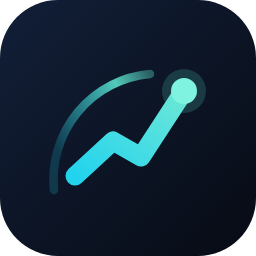

<p align="center"></p>

# OKX Quant Radar

**跑在你自己电脑上的 OKX 永续合约自动化交易系统** —— 定时扫描全市场、按多周期信号自动开仓、自动挂止盈止损，配一个本地控制台和一个数据看板。

> 本项目是 [OKX AI Builder Program](https://www.okx.com/agent-tradekit/builder) 的接入项目：所有交易通过 OKX 官方命令行工具提交，并在下单时携带 AI Builder Code 用于归因。

---

## 这是什么

- **全市场扫描**：按固定轮次拉取永续合约行情，用多周期（15m / 1H / 4H）方向一致性 + 趋势强度筛选候选标的
- **自动下单**：限价或市价开仓，自动按风险参数计算名义仓位与杠杆
- **自动风控**：成交后自动挂 OCO（止盈 + 止损）、移动止盈；未成交挂单超时自动撤销
- **本地控制台**：开 / 停交易、调整参数、查看运行状态，全部在你自己的机器上
- **数据看板**：持仓、当前信号、成交记录、策略表现的本地 Web 页面

## 这不是什么（请先看这一段）

| 不是 | 说明 |
|---|---|
| ❌ 不是托管服务 | 你的 API Key 只保存在**你自己的机器上**，我们不接触、不收集、不上传 |
| ❌ 不是代客理财 / 跟单 | 资金始终在你自己的 OKX 账户里，程序只是替你执行 |
| ❌ 不承诺任何收益 | 我们不做任何收益率承诺。自动化交易存在**重大亏损风险** |
| ❌ 不是云端 SaaS | 没有中心服务器代持你的账户，程序完全在你本地运行 |

## 运行形态

| 平台 | 形态 | 适用 |
|---|---|---|
| Windows | 单个 EXE，双击启动本地控制台 | 本地验证、日常使用 |
| Linux | `tar.gz` + `install.sh`，systemd 常驻 | 7×24 无人值守，跑在 VPS 上 |

**依赖**：Node.js LTS（≥18）+ OKX 官方命令行工具 [`@okx_ai/okx-trade-cli`](https://www.npmjs.com/package/@okx_ai/okx-trade-cli)。
程序启动时会自动检测这两项，缺失会直接提示安装命令，不会带着残缺环境硬跑。

## 交易链路

所有下单动作都通过 **OKX 官方命令行工具**执行，不经过任何第三方签名库或中转代理：

```
策略轮次 → 生成信号 → okx swap place       （开仓：限价 / 市价）
                      → okx swap algo place （成交后：OCO 止盈止损）
                      → okx swap algo trail （可选：移动止盈）
                      → okx swap place --reduceOnly （平仓）
```

请求直连 OKX，签名由官方工具在你本机完成。
接入 AI Builder 后，下单调用会携带 `--aiBuilderCode` 参数用于返佣归因（不影响任何交易逻辑）。

## 前置要求

1. **你自己的 OKX 账户**，以及你自己创建的 API Key
   （创建后**只勾选「读取」和「交易」权限，不要开提币权限**）
2. **建议单独开一个子账户**给这个程序用，只放你愿意承担风险的资金，与主账户隔离
3. **先跑模拟盘（demo）**跑通，确认信号、下单、止盈止损都正常，再切实盘

## 安全设计

- 密钥保存在你本机 `~/.okx/config.toml`，由 OKX 官方 CLI 读取并在本地签名；程序本身不读取、不打印、不上传密钥
- 程序日志只记录订单号与参数，不记录密钥
- 切到实盘启动时有二次确认（需手动输入 `yes`），并在界面上标明「实盘 · 真实资金」
- 未成交的挂单超时自动撤销，避免隔夜裸挂
- 建议绑定 IP 白名单，降低密钥泄露风险

## 风险提示（务必阅读）

- 数字资产合约交易具有**高杠杆、高波动**特性，可能导致全部本金损失
- 自动化程序可能因为网络中断、接口限频、参数配置错误、极端行情等原因产生非预期下单
- 本项目不构成任何投资建议，不承诺任何收益，历史表现不代表未来结果
- **请只投入你完全亏得起的资金**，并在实盘放大资金前进行充分的小额验证
- 使用本项目的全部风险与后果由使用者自行承担

## 状态

- 当前版本：持续迭代中
- 接入状态：正在接入 OKX AI Builder Program（交易走官方 CLI，下单携带 Builder Code 用于归因）

## 联系

- 问题反馈 / 部署咨询：请在 [Issues](https://github.com/cnjuly1993/okx-quant-radar/issues) 中提出
